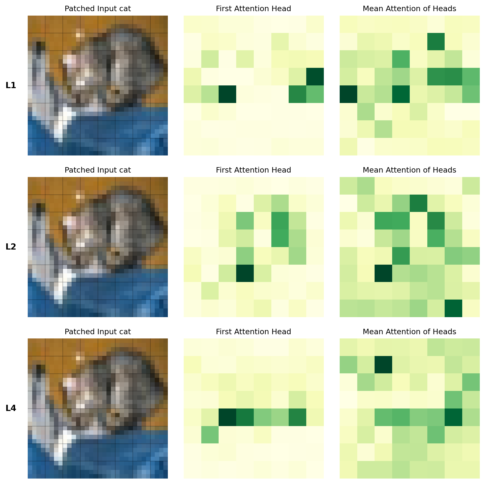
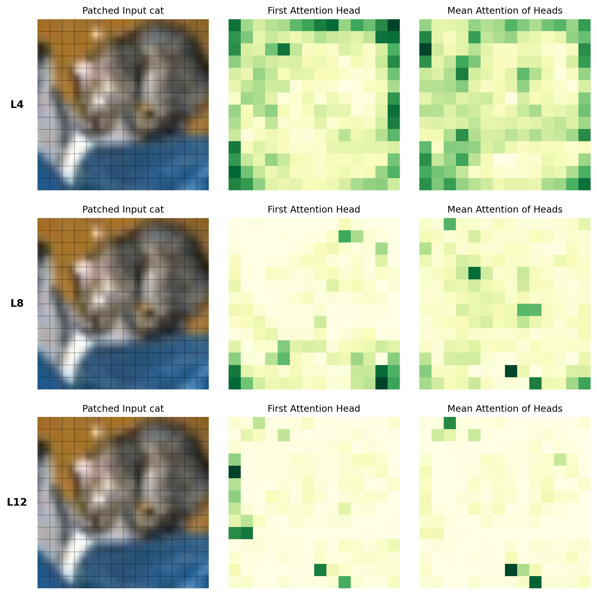
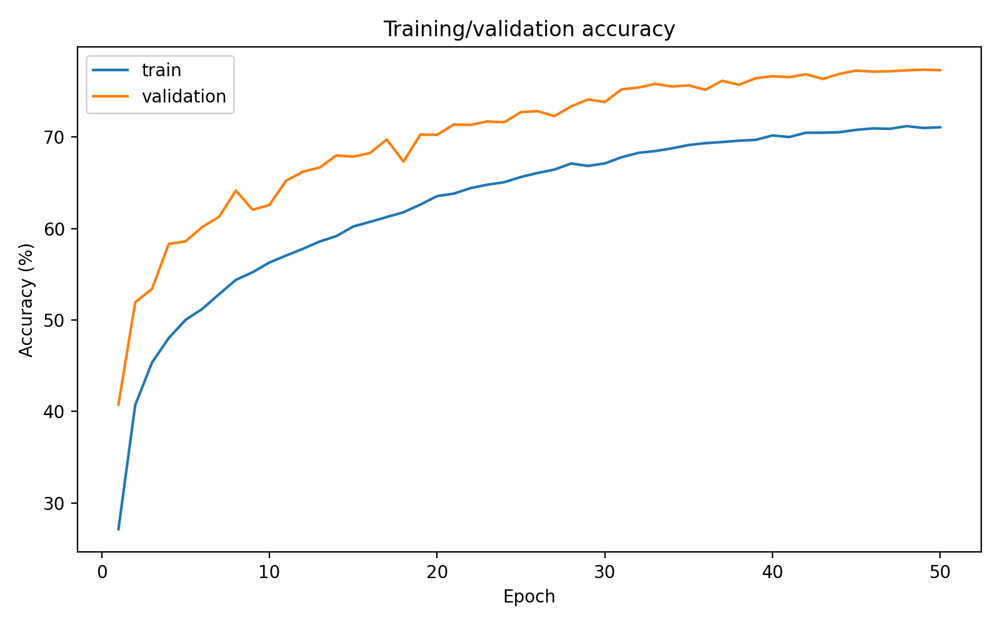
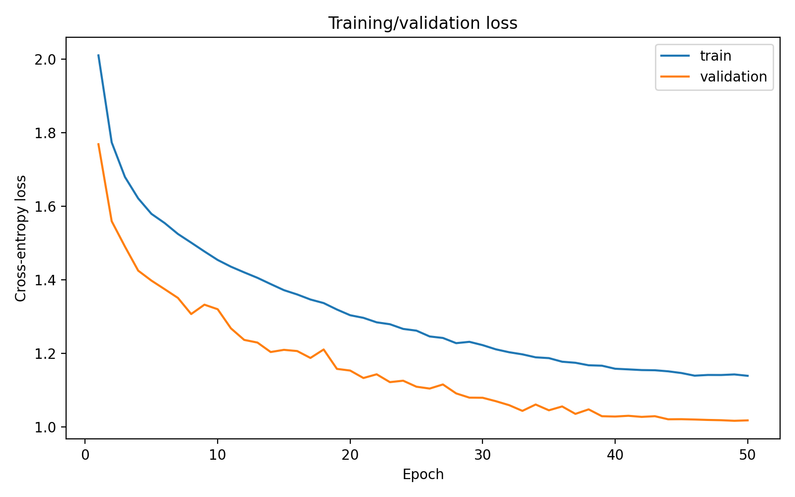

# Vision Transformers from Scratch: CIFAR-10 Ablations and Attention Analysis

**A reproducible PyTorch study of Vision Transformer architecture, scaling trade-offs, and self-attention behavior on CIFAR-10.**

This repository implements a compact Vision Transformer (ViT) **from first principles**—including patch embeddings, multi-head scaled dot-product attention, pre-normalization Transformer blocks, learnable positional embeddings, and a classification token—and studies how embedding width, depth, patch size, and input resolution affect classification performance. It also extracts and visualizes attention from both the trained scratch model and an ImageNet-pretrained ViT-B/16.

**Best recorded result:** **79.81% CIFAR-10 test accuracy** with 64×64 resized inputs, compared with **76.48%** for the 32×32 baseline. These are results from the included experiment logs, not averages over multiple seeds.

## Research questions

- **Representation capacity:** How do token-embedding width and Transformer depth affect accuracy and parameter count?
- **Tokenization:** What is the trade-off between patch granularity, attention-matrix size, and predictive performance?
- **Input resolution:** Does resizing the same low-resolution images change the effectiveness of patch-based representations?
- **Attention analysis:** How do class-token attention patterns vary across layers and heads, and how do visualizations differ between a small scratch-trained ViT and an ImageNet-pretrained ViT-B/16?

The project is an **empirical implementation and ablation study**, not a claim of a new Transformer architecture.

## Key results

All scratch models were trained for **50 epochs** on the same seeded CIFAR-10 training/validation split. Unless indicated, each experiment changes one architectural setting from the baseline. Checkpoints were selected using **validation accuracy**, then evaluated on the held-out test set.

| Experiment | Input | Patch | Layers | Embed. dim | Tokens | Parameters | Best val. acc. | Test acc. |
|:--|--:|--:|--:|--:|--:|--:|--:|--:|
| **Baseline** | 32×32 | 4×4 | 4 | 128 | 65 | 414,602 | 77.38% | **76.48%** |
| Embedding: 64 | 32×32 | 4×4 | 4 | 64 | 65 | 142,026 | 69.46% | 68.72% |
| Embedding: 256 | 32×32 | 4×4 | 4 | 256 | 65 | 1,352,970 | 79.78% | 79.43% |
| Depth: 2 | 32×32 | 4×4 | 2 | 128 | 65 | 215,434 | 72.46% | 71.25% |
| Depth: 8 | 32×32 | 4×4 | 8 | 128 | 65 | 812,938 | 79.20% | 78.90% |
| Patch: 2×2 | 32×32 | 2×2 | 4 | 128 | 257 | 434,570 | 76.58% | 76.02% |
| Patch: 8×8 | 32×32 | 8×8 | 4 | 128 | 17 | 426,890 | 67.46% | 64.98% |
| **Input: 64×64** | 64×64 | 4×4 | 4 | 128 | 257 | 439,178 | **80.56%** | **79.81%** |

*Source: `outputs/logs/*_result.json`; parameter counts and token counts are recorded by the training scripts. Accuracy is top-1 classification accuracy. The 64×64 experiment uses batch size 96 rather than the baseline's 128; it is therefore not a strictly isolated resolution intervention.*

### Findings

1. **Width and depth improve performance within the tested range.** Increasing embedding width from 128 to 256 raises test accuracy by **2.95 percentage points**; increasing depth from 4 to 8 blocks raises it by **2.42 points**. Both changes increase parameter count substantially.
2. **Finer patches are not automatically better.** A 2×2 patch increases token count from 65 to 257 but gives a slightly *lower* test accuracy (**76.02% vs. 76.48%**). In contrast, 8×8 patches reduce the sequence to 17 tokens but decrease accuracy to **64.98%**.
3. **The 64×64 input setting gives the strongest recorded accuracy.** Resizing from 32×32 does **not** create new image detail; it changes the sampled representation and tokenization, and it also increases attention cost. Its batch size differs, so the observed gain should not be attributed to resolution alone.
4. **The experiments expose an accuracy–compute trade-off.** At fixed attention-head count and depth, moving from 65 to 257 tokens increases the number of stored attention-matrix elements per forward pass by approximately **15.6×**. This is a matrix-size proxy, not a measured FLOP count or runtime benchmark.

These are **single-run observations**, not statistically established effects: no multi-seed averages, confidence intervals, or significance tests are reported.

## Model and mathematics

### 1. Patch embedding and token sequence

For an image with height and width `H`, patch size `P`, and embedding dimension `D`, the number of non-overlapping image patches is

```math
N = \left(\frac{H}{P}\right)^2.
```

A convolution with kernel and stride equal to `P` implements a learned projection of each patch. A trainable class token is prepended and learned positional embeddings are added:

```math
\mathbf{Z}_0 = [\mathbf{x}_{\mathrm{cls}};\mathbf{x}_1;\ldots;\mathbf{x}_N] + \mathbf{E}_{\mathrm{pos}},
\qquad \mathbf{Z}_0 \in \mathbb{R}^{(N+1)\times D}.
```

The baseline transforms a **32×32 RGB image** into an **8×8 patch grid**, or **64 patch tokens + 1 class token**.

### 2. Explicit multi-head self-attention

Each head projects its input into queries, keys, and values. With `h` heads, the per-head dimension is `d = D/h`:

```math
\mathbf{Q}_i = \mathbf{Z}\mathbf{W}_i^Q,\qquad
\mathbf{K}_i = \mathbf{Z}\mathbf{W}_i^K,\qquad
\mathbf{V}_i = \mathbf{Z}\mathbf{W}_i^V.
```

```math
\mathbf{A}_i = \mathrm{softmax}\left(\frac{\mathbf{Q}_i\mathbf{K}_i^\top}{\sqrt{d}}\right),
\qquad
\mathrm{MHSA}(\mathbf{Z}) = [\mathbf{A}_1\mathbf{V}_1;\ldots;\mathbf{A}_h\mathbf{V}_h]\mathbf{W}^{O}.
```

The softmax is taken across key-token positions. `models/model.py` computes the `QKᵀ` logits, attention probabilities, and weighted value aggregation explicitly; it does **not** use `nn.MultiheadAttention` or `nn.TransformerEncoder` for the scratch model.

### 3. Pre-normalization Transformer encoder

Each encoder block uses layer normalization before attention and before the two-layer GELU MLP, with residual connections around both sublayers:

```math
\mathbf{U}_{\ell} = \mathbf{Z}_{\ell-1} + \mathrm{MHSA}(\mathrm{LN}(\mathbf{Z}_{\ell-1})),
```

```math
\mathbf{Z}_{\ell} = \mathbf{U}_{\ell} + \mathrm{MLP}(\mathrm{LN}(\mathbf{U}_{\ell})).
```

After the final layer normalization, a linear classifier maps the final class-token representation to ten logits.

### 4. Attention visualization

The implementation can retain either **pre-softmax scaled query–key similarities** or **post-softmax attention probabilities**. To display attention associated with the class token, it selects the class-token query row, removes the class-to-class entry, and reshapes the remaining values into the patch grid:

```math
\mathbf{M}_i = \mathrm{reshape}\left(\mathbf{A}_i[0,1:N+1],\;H/P,\;H/P\right).
```

Plots show one selected head and the mean across heads for several layers. **Panel heatmaps are min–max normalized individually for visual contrast**; their color intensities should not be compared quantitatively between panels. Attention weights describe information routing within a layer, **not** a causal feature-attribution explanation.

### Baseline configuration

| Component | Specification |
|:--|:--|
| Dataset | CIFAR-10, 10 classes |
| Input and patches | 32×32 RGB, 4×4 non-overlapping patches |
| Encoder | 4 pre-LN Transformer blocks |
| Attention | 8 heads, embedding dimension 128 (16 per head) |
| MLP | Hidden dimension 128, GELU |
| Regularization | Dropout 0.1; attention dropout 0.1 |
| Classification | Learned class token + final LayerNorm + linear head |
| Optimization | AdamW, initial learning rate 5×10⁻⁴, weight decay 0.05 |
| Scheduling | Cosine annealing to 10⁻⁶ over 50 epochs |
| Objective | Cross-entropy with label smoothing 0.1 |
| Training | Batch size 128, gradient clipping at norm 1.0, CUDA AMP when available |
| Augmentation | Random crop, horizontal flip, RandAugment (2 operations, magnitude 9) |
| Split | 45,000 training / 5,000 validation / 10,000 test; seed 42 |

The embedding-width variants retain the **same 128-unit MLP hidden width**, so they also alter the ratio of MLP width to embedding width. All scratch configurations use eight attention heads.

## Attention maps: scratch vs. pretrained

### Scratch-trained ViT — layers 1, 2, and 4



*Class-token attention from the **best baseline checkpoint**, visualized on a CIFAR-10 test image. Rows correspond to encoder layers; columns show the image patch grid, head 0, and the mean over eight heads.*

### ImageNet-pretrained ViT-B/16 — layers 4, 8, and 12



*Attention from `torchvision.models.vit_b_16(weights=ViT_B_16_Weights.DEFAULT)`, using its prescribed ImageNet preprocessing. The original 32×32 CIFAR-10 image is resized/cropped to **224×224**, yielding a **14×14** grid of 16×16 patches. This model is **not fine-tuned on CIFAR-10** and is used here **only for visualization**, not for the scratch-model accuracy table.*

The pretrained model's attention maps are reconstructed from its learned query/key projection weights using **forward pre-hooks**, because the TorchVision encoder calls its attention modules without returning attention weights. The two models differ in training data, scale, preprocessing, patch count, and network depth; their visualizations are therefore **qualitative examples rather than a controlled explanation of their relative performance**.

Additional attention maps for a second test image, individual layers/heads, full token-to-token matrices, and pre-softmax similarities are provided in `outputs/attention_maps/`.

## Training curves

| Baseline accuracy | Baseline cross-entropy loss |
|:--:|:--:|
|  |  |

Training accuracy is computed under random training augmentation, whereas validation accuracy uses deterministic evaluation transforms; the two curves are therefore not measurements under identical input distributions. All eight experiments include corresponding CSV logs and accuracy/loss figures under `outputs/logs/` and `outputs/plots/`.

## Reproduce the experiments

### Installation

Use a Python environment with a compatible PyTorch/TorchVision installation. A CUDA GPU is recommended for the complete sweep, although the training code can also run on CPU.

```bash
python -m venv .venv
source .venv/bin/activate            # Windows: .venv\Scripts\activate
pip install -r requirements.txt
```

The code imports NumPy directly; if your copy of `requirements.txt` does not list it, install it with `pip install numpy`.

**Run commands from the repository root** (the directory containing `config/`, `scripts/`, and `models/`). CIFAR-10 downloads automatically into `data/dataset/` on first use. The pretrained attention command also downloads TorchVision's ImageNet weights if they are not cached.

### Train the baseline

```bash
python scripts/main.py --mode train --experiment baseline
```

### Run all seven architectural/input ablations

```bash
python scripts/main.py --mode sweep
```

**Note:** `--mode sweep` runs the seven entries under `experiments:` in the YAML configuration; it **does not rerun the baseline**. To train an individual variant:

```bash
python scripts/main.py --mode train --experiment embed_dim_256
```

Valid variant names are `embed_dim_64`, `embed_dim_256`, `depth_2`, `depth_8`, `patch_2`, `patch_8`, and `image_size_64`.

### Evaluate a saved checkpoint

```bash
python scripts/main.py --mode evaluate --experiment baseline
# Or supply an explicit path:
python scripts/main.py --mode evaluate --checkpoint models/saved_models/depth_8_best.pt
```

### Generate attention maps

```bash
# Scratch baseline: layers 1, 2, and 4, first head + average over heads
python scripts/main.py --mode attention_scratch --experiment baseline --head-index 0 --num-images 2

# Scratch model: show pre-softmax QK similarities instead
python scripts/main.py --mode attention_scratch --experiment baseline --use-logits

# ImageNet-pretrained ViT-B/16: layers 4, 8, and 12
python scripts/main.py --mode attention_pretrained --head-index 0
```

### Outputs and checkpoints

For each training run the code writes:

- `models/saved_models/<experiment>_best.pt` and `<experiment>_last.pt` — model states and configuration.
- `outputs/logs/<experiment>_history.csv` — epoch-level loss, accuracy, and learning rate.
- `outputs/logs/<experiment>_result.json` — selected validation accuracy, test metrics, parameter count, token count, and runtime.
- `outputs/plots/<experiment>_history_accuracy.png` and `<experiment>_history_loss.png` — learning curves.

The `_best.pt` checkpoint is selected by **highest validation accuracy**, not lowest test loss. The test set is evaluated after checkpoint selection.

## Repository layout

```text
.
├── config/
│   └── config.yaml                 # Baseline and ablation overrides
├── data/
│   └── data_loader.py              # Seeded split, transforms, loaders
├── models/
│   ├── model.py                    # From-scratch ViT and attention
│   └── saved_models/               # Best/last checkpoints for each run
├── scripts/
│   ├── main.py                     # CLI: train, sweep, evaluate, attention
│   ├── train.py                    # Training and experiment logging
│   └── evaluate.py                 # Checkpoint eval and attention extraction
├── utils/
│   ├── metrics.py                  # Accuracy, parameter/token counting
│   └── visualization.py            # Learning curves and attention plots
├── outputs/
│   ├── logs/                       # Per-run CSV and JSON results
│   ├── plots/                      # Training curves
│   └── attention_maps/
│       ├── scratch/                # Scratch-model attention visualizations
│       └── pretrained_vit_b_16/   # Pretrained-model attention visualizations
├── requirements.txt
└── README.md
```

## Limitations and directions for further study

- **Single seed:** reported accuracies come from one training run per setting. Multiple seeds and uncertainty intervals would be needed to quantify robustness.
- **Partial isolation of variables:** the 64×64 experiment also changes the batch size; width variants hold MLP hidden width fixed rather than preserving the MLP/embedding ratio.
- **Compute reporting:** the recorded `attention_matrix_elements_proxy` is `layers × heads × tokens²`; it is not measured training memory usage, multiply-accumulate count, or hardware-normalized runtime.
- **Resizing:** upsampling 32×32 CIFAR-10 images is not equivalent to collecting genuinely higher-resolution data.
- **Interpretability:** class-token attention is a diagnostic visualization, not proof of which pixels cause a prediction. Quantitative attribution tests or attention perturbations would strengthen the analysis.
- **Reproducibility:** a random seed and seeded data split are used, but GPU kernels are not forced into strictly deterministic execution; exact replication may depend on PyTorch, hardware, and library versions.

Useful follow-up experiments would include multi-seed confidence intervals, equal-compute comparisons, matched batch sizes for the resolution ablation, and systematic quantification of attention concentration across layers and classes.

## References

1. Dosovitskiy, A., et al. **[An Image Is Worth 16×16 Words: Transformers for Image Recognition at Scale](https://arxiv.org/abs/2010.11929)**. *ICLR*, 2021.
2. Krizhevsky, A. **[Learning Multiple Layers of Features from Tiny Images](https://www.cs.toronto.edu/~kriz/learning-features-2009-TR.pdf)**. Technical report, 2009. See also the [official CIFAR-10 dataset page](https://www.cs.toronto.edu/~kriz/cifar.html).
3. PyTorch. **[TorchVision ViT-B/16 documentation](https://docs.pytorch.org/vision/stable/models/generated/torchvision.models.vit_b_16.html)** (pretrained weights and preprocessing).

---

**Scope:** This repository documents a from-scratch implementation, recorded empirical ablations, and attention analysis. It does not claim state-of-the-art CIFAR-10 accuracy or a new attention method.
